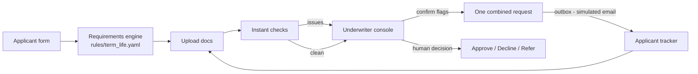

# Design

**Statuses:** REQUIREMENTS_PENDING → UNDER_REVIEW → DECIDED
**Key decisions:** rules in YAML (changeable without code); all issues returned together; approval blocked with open issues;
role check on underwriter endpoints; audit log for every action; AI optional, gets issue text only, verified + fallback.
